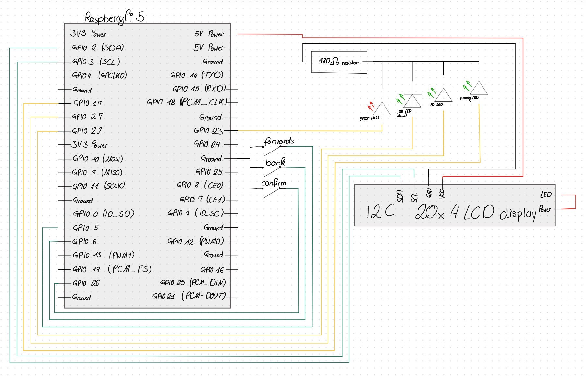
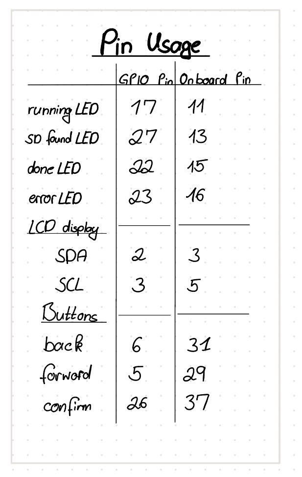

# CardFerry

Raspberry Pi SD card backup station with LCD menu, buttons and status LEDs



CardFerry is a small standalone device built around a Raspberry Pi. Plug in a microSD card (for example from a camera), pick a user with the buttons, and CardFerry copies the whole card to a folder for that user. Afterwards you can choose to erase the card so it is ready for the next shoot. Everything is controlled with three buttons, a 20x4 LCD and four status LEDs, so no monitor or keyboard is needed.

## Contents

- [How it works](#how-it-works)
- [What data does CardFerry touch?](#what-data-does-cardferry-touch)
- [Compatibility](#compatibility)
- [Hardware](#hardware)
- [Installation](#installation)
- [Enabling I2C](#enabling-i2c)
- [Configuration](#configuration)
- [Usage](#usage)
- [Start automatically at boot](#start-automatically-at-boot)
- [Troubleshooting](#troubleshooting)
- [Known limitations](#known-limitations)
- [Project structure](#project-structure)
- [License](#license)

## How it works

1. CardFerry starts, the **running LED** lights up and the LCD shows `insert SD-card`.
2. You insert a card. The **SD LED** lights up and the LCD shows `select user`.
3. Choose a user with the **forward / back** buttons and press **confirm**.
4. The card is copied to `/backup-data/<user>/`. When it is done, the **OK LED** lights up.
5. The LCD asks `erase SD-card?` with `Yes` / `No`. `No` is preselected.
   - `No`: the card stays untouched.
   - `Yes`: release confirm, then press **confirm again within 3 seconds** to really erase. If you do not press again, you are taken back to the question.
6. The LCD shows `take out SD-card`. Once the card is removed, all LEDs go off and CardFerry is ready for the next card.

If copying fails, the **error LED** lights up and the card is never erased.

### LED meaning

| LED     | Meaning                                                           |
|---------|-------------------------------------------------------------------|
| Running | CardFerry is running                                                 |
| SD      | A card was detected                                               |
| OK      | Backup finished successfully                                      |
| Error   | Backup failed, or `users.json` is missing or invalid              |

## What data does CardFerry touch?

**Read**
- All files and folders on the inserted card (the first mounted volume found under `/media/<your user>/`).
- `src/users.json` (the list of user names).
- Nothing else on the Pi and no other drives.

**Written**
- A copy of the card content in `/backup-data/<selected user>/`, with folder structure and file timestamps preserved.

**Changed or deleted**
- Only if you choose `Yes` **and** confirm twice: every file and folder on the card is deleted. The card is not formatted, and this is not a secure erase (deleted data may be recoverable with special tools).

**Not done**
- No network access, no cloud upload, no data leaves the Pi.

**Good to know**
- Files with the same name in a user's backup folder are **overwritten** by the next backup. Cameras often reuse file names, so move or rename old backups before copying a new card of the same camera.
- The copy is **not verified** (no checksum comparison) before you can erase the card. Check your backup if the data is important.
- By default `/backup-data` is on the Pi's own SD card, which has limited space. For real use, mount an external drive or USB stick at `/backup-data`.

## Compatibility

| System                                         | Status                                      |
|------------------------------------------------|---------------------------------------------|
| Raspberry Pi OS (tested on: Raspberry Pi 5, every newer OS) | Tested, works                   |
| Raspberry Pi OS Lite                           | Untested (cards may not be auto-mounted, see below) |
| Other Linux distributions on a Pi              | Untested                                    |
| Windows, macOS, normal PCs                     | Not supported (needs Raspberry Pi GPIO)     |

**Requirement: automatic mounting.** CardFerry looks for the card under `/media/<your user>/`. Raspberry Pi OS with desktop mounts inserted media there automatically. If your system does not do that, the card will not be found.

## Hardware

- Raspberry Pi with 40-pin header
- USB microSD card reader (the card you want to back up)
- 20x4 character LCD with I2C backpack (PCF8574, default address `0x27`)
- 4 LEDs (running, SD found, done/OK, error) with a series resistor each (about 180 Ω)
- 3 push buttons (back, forward, confirm)
- Breadboard or perfboard and jumper wires

### Wiring



| Function     | GPIO (BCM) | Physical pin |
|--------------|-----------:|-------------:|
| Running LED  | 17         | 11           |
| SD found LED | 27         | 13           |
| Done LED     | 22         | 15           |
| Error LED    | 23         | 16           |
| LCD SDA      | 2          | 3            |
| LCD SCL      | 3          | 5            |
| Button back  | 6          | 31           |
| Button forward | 5        | 29           |
| Button confirm | 26       | 37           |

- LEDs: GPIO pin, then LED, then resistor, then GND. Use one resistor per LED so the brightness does not depend on how many LEDs are on.
- Buttons: one side to the GPIO pin, the other side to GND. The internal pull-up resistors are enabled in software, so no external resistors are needed.
- LCD: connect GND and VCC as well as SDA and SCL. Most I2C backpacks expect 5 V on VCC. Be careful: if the backpack pulls SDA/SCL up to 5 V, this can stress the Pi's 3.3 V pins. A level shifter or a backpack with pull-ups to 3.3 V is the safe option.
- If the LCD stays blank, turn the small blue contrast potentiometer on the backpack.

See `docs/wiring.jpeg` for the full wiring drawing.

## Installation

### Quick start (download and run)

1. On GitHub, click **Code → Download ZIP**.
2. Copy the ZIP to your Raspberry Pi and extract it, for example:
3. Run the installer (do **not** use `sudo`, it asks for the password when needed):
   It installs the required packages, creates a virtual environment, enables I2C, creates the backup folder `/backup-data` and `src/users.json`, and optionally sets up autostart.
4. Reboot when the installer tells you to:
5. Edit your users in `src/users.json` (see [Configuration](#configuration)).
6. Start CardFerry:
   ```bash
   cd CardFerry-main
   ./venv/bin/python src/main.py
   ```

### Manual installation

```bash
sudo apt update
sudo apt install -y python3-venv python3-dev build-essential i2c-tools
sudo apt install -y python3-rpi.gpio          # optional, otherwise pip builds RPi.GPIO
python3 -m venv --system-site-packages venv
./venv/bin/pip install -r requirements.txt
sudo raspi-config nonint do_i2c 0             # enable I2C (see below)
sudo usermod -aG i2c,gpio "$USER"
sudo mkdir -p /backup-data && sudo chown "$USER" /backup-data
cp src/users.example.json src/users.json
sudo reboot
```

On current Raspberry Pi OS versions, `pip install` outside a virtual environment is blocked ("externally-managed-environment"), which is why a venv is used.

## Enabling I2C

**What is I2C?** I2C is a simple two-wire bus (one wire for data, `SDA`, one for the clock, `SCL`) that the Pi uses to talk to small devices. The LCD has an I2C backpack, so it needs only these two signal wires instead of about six.

**Why is it needed?** I2C is switched off by default on Raspberry Pi OS. Without it the Pi cannot talk to the display and CardFerry stops at start with an error such as `FileNotFoundError: /dev/i2c-1` or `OSError: [Errno 121] Remote I/O error`.

**How to enable it**

- Terminal:
  ```bash
  sudo raspi-config
  ```
  Then choose **Interface Options → I2C → Yes**, finish, and reboot.
- Or in one command: `sudo raspi-config nonint do_i2c 0`
- Or on the desktop: **Menu → Preferences → Raspberry Pi Configuration → Interfaces → I2C → Enable**.

**Check that the display is found**

```bash
sudo apt install -y i2c-tools
i2cdetect -y 1
```

You should see `27` in the table. Some backpacks use `3f` instead. In that case change `address=0x27` to `address=0x3F` in `src/main.py`.

## Configuration

**Users** are stored in `src/users.json`, so you never have to edit the code to add or remove people:

```json
{
  "users": ["Alice", "Bob"]
}
```

- Keep names at most 19 characters long so they fit on the 20-character LCD.
- Restart CardFerry after changing the file.
- `src/users.json` is not part of the repository (it is in `.gitignore`). `src/users.example.json` is the template.
- If the file is missing or invalid, the LCD shows `users.json missing or invalid` and the error LED lights up.

**Other settings** are constants at the top of `src/main.py`: the GPIO pins, the LCD address, the SD card mount path and the backup folder.

## Usage

1. Start CardFerry (manually or via autostart). Wait for `insert SD-card`.
2. Insert the card into the reader.
3. Select your user with **forward / back**, confirm with **confirm**.
4. Wait for `backup done` and the OK LED.
5. Decide whether to erase the card (see [How it works](#how-it-works)).
6. Take out the card when the LCD says so.

Your files are in `/backup-data/<user>/`.

> **Warning:** CardFerry can delete everything on a card. Test it first with a card that holds no important data.

## Start automatically at boot

The installer offers to set this up. To do it by hand, create `/etc/systemd/system/CardFerry.service` (adjust user and path):

```ini
[Unit]
Description=CardFerry SD card backup station
After=multi-user.target

[Service]
User=pi
ExecStart=/home/pi/CardFerry-main/venv/bin/python /home/pi/CardFerry-main/src/main.py
Restart=on-failure
RestartSec=5

[Install]
WantedBy=multi-user.target
```

Then:

```bash
sudo systemctl daemon-reload
sudo systemctl enable --now CardFerry.service
```
## Known limitations

- Only the first mounted volume of a card is backed up.
- Backups are not verified before you can erase the card.
- Existing files of the same name in a user's folder are overwritten, and there are no timestamped backup folders yet.
- Not tested on Pi 5, Raspberry Pi OS Lite or other distributions.

Ideas for the future: checksum verification before erasing, timestamped backup folders, a progress bar on the LCD, support for several partitions.

## License

MIT, see [LICENSE](LICENSE).